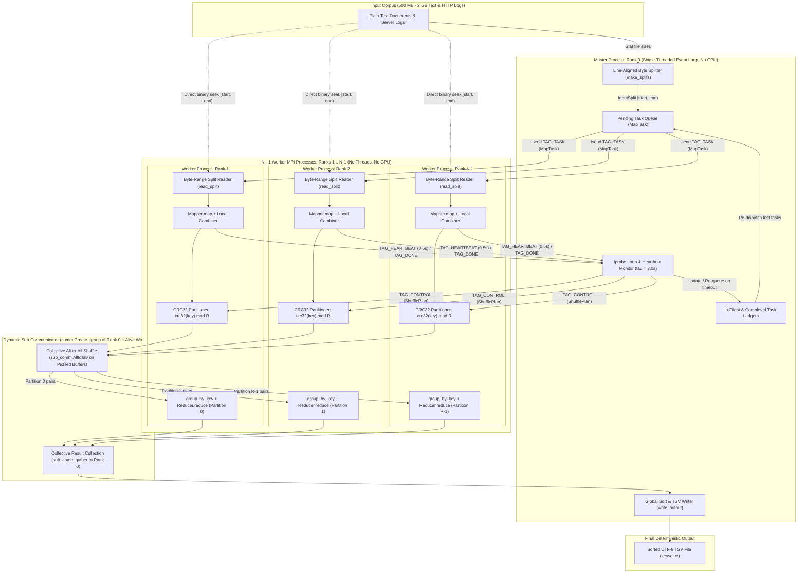

# System Architecture: Lightweight Distributed MapReduce on MPI Processes

This document presents the system architecture of the lightweight MapReduce framework (Figure 1 of the project proposal), illustrating the **1 Master + $(N - 1)$ Worker MPI process topology** (no threads, no GPU kernels), the end-to-end data flow, and its parallel architecture classification.

---

## 1. Process Topology & Communication Architecture

The framework executes across $N$ independent OS processes launched via `mpiexec -n N python mr_driver.py` ($N \in \{2, 3, 5, 9\}$, yielding $1$ Master and $p = N - 1 \in \{1, 2, 4, 8\}$ Workers):

---

## 2. End-to-End Data Flow

1. **Non-Copying Byte-Range Splitting (`Rank 0`)**:
   - The Master process inspects the input file sizes (`mapreduce.splitter.make_splits`) and partitions the corpus into logical `InputSplit(split_id, path, start, end)` descriptors (default 16 MiB per split) without reading or copying file contents.
2. **Dynamic Map Scheduling & Liveness Tracking (`Rank 0` $\leftrightarrow$ `Ranks 1..N-1`)**:
   - The Master feeds splits from a dynamic task queue to idle workers using non-blocking `comm.isend` (`TAG_TASK`), naturally load-balancing unevenly sized lines or skew across splits.
   - Each worker seeks directly to `[start, end)` in the underlying file (`read_split`), decodes owned lines (`key=(doc_id, offset), value=line`), and executes `Mapper.map`.
   - Every `0.5` s (`HEARTBEAT_INTERVAL`), workers emit a `Heartbeat` (`TAG_HEARTBEAT`) inline from their map loop. The master polls with `comm.Iprobe`: if any worker stays silent for longer than $\tau = 3.0\text{ s}$ (`TIMEOUT_TAU`), the master declares it failed and re-queues **both** its in-flight and completed map tasks from the task ledgers.
3. **Map-Side Combining & Retention in Worker Memory (`Ranks 1..N-1`)**:
   - At the end of each map task, the worker applies the workload's `Combiner` (`api.run_reducer`) to pre-aggregate duplicate keys locally (summing partial word counts for Word Frequency; deduplicating `(term, doc_id)` pairs for Inverted Index).
   - Intermediate pairs are retained in the worker's own RAM indexed by `task_id`, and a lightweight `TaskDone` acknowledgment (`TAG_DONE`) is sent to the master.
4. **Hash Partitioning & Surviving-Group `Alltoallv` Shuffle (`sub_comm`)**:
   - When all map tasks complete, the master sends `ShufflePlan(alive, accepted)` (`TAG_CONTROL`) to surviving workers.
   - Master and surviving workers construct a sub-communicator `sub_comm` via `comm.Create_group` containing only `[0, *alive]`, isolating any silent failed worker.
   - Each surviving worker filters its local task outputs using `ShufflePlan.accepted`, hashes every intermediate key to a target reducer $r = \text{CRC32}(\text{key}) \bmod R$ ($R = |\text{alive}|$), pickles the $R$ partition buckets into contiguous byte buffers, and executes a collective `sub_comm.Alltoallv` exchange.
5. **Parallel Partition Reduction (`Ranks in alive`)**:
   - Each surviving worker $r \in \{0, \dots, R-1\}$ deserializes the $R$ buffers routed to partition $r$, groups values by sorted key (`api.group_by_key`), and executes `Reducer.reduce`.
6. **Gather, Global Output Sort, and Shutdown (`sub_comm` $\to$ `Rank 0`)**:
   - Reduced `(key, value)` pairs are collected at the Master via `sub_comm.gather(..., root=0)`.
   - The Master writes the globally key-sorted `key<TAB>value\n` file (`api.write_output`), frees `sub_comm`, and broadcasts `Shutdown` (`TAG_CONTROL`) over `MPI.COMM_WORLD` so all ranks terminate cleanly.

---

## 3. Parallel Architecture Classification: MIMD & Distributed Memory

- **Flynn's Taxonomy — MIMD (Multiple Instruction, Multiple Data)**:
  - Each MPI rank is an autonomous OS process with its own program counter and instruction stream operating asynchronously on distinct data subsets (`InputSplit`s during Map; disjoint key-hash partitions during Reduce).
  - Furthermore, the system adopts an asymmetric **Master/Worker MIMD** execution model: Rank 0 executes scheduling, ledger management, and fault monitoring instructions, while Ranks $1 \dots N-1$ execute I/O, tokenization, combining, hashing, and reduction instructions.
- **Memory Model — Distributed Memory (Message Passing over Shared-Memory Transport)**:
  - Each rank runs in a private virtual address space with zero shared state. All coordination and intermediate data movement occur through explicit MPI point-to-point (`isend`/`recv`/`Iprobe`) and collective (`Create_group`/`Alltoallv`/`gather`) message passing.
  - **No Threads / No GIL Bottleneck**: Because CPython's Global Interpreter Lock (GIL) serializes CPU-bound Python bytecode within a single process, multi-threading cannot scale CPU-intensive tokenization and hashing. Running $N$ independent single-threaded Python OS processes bypasses the GIL entirely while keeping the control loop free of lock-contention and race-condition bugs.
  - **No GPU Kernels**: String tokenization, regular-expression matching, dictionary grouping, and variable-length posting-list aggregation are irregular, branch-heavy, memory-bound workloads suited to multi-core MIMD CPUs rather than SIMD/SIMT GPU kernels.
  - **Local Shared-Memory MPI Fabric**: When launched on a single multi-core workstation (e.g., Intel Core i7 with 4 physical cores / 8 hardware threads), the MPI runtime (Intel MPI / MS-MPI / OpenMPI) transparently maps `Alltoallv` and point-to-point transfers onto fast OS shared-memory ring buffers while preserving pure distributed-memory semantics in application code.
