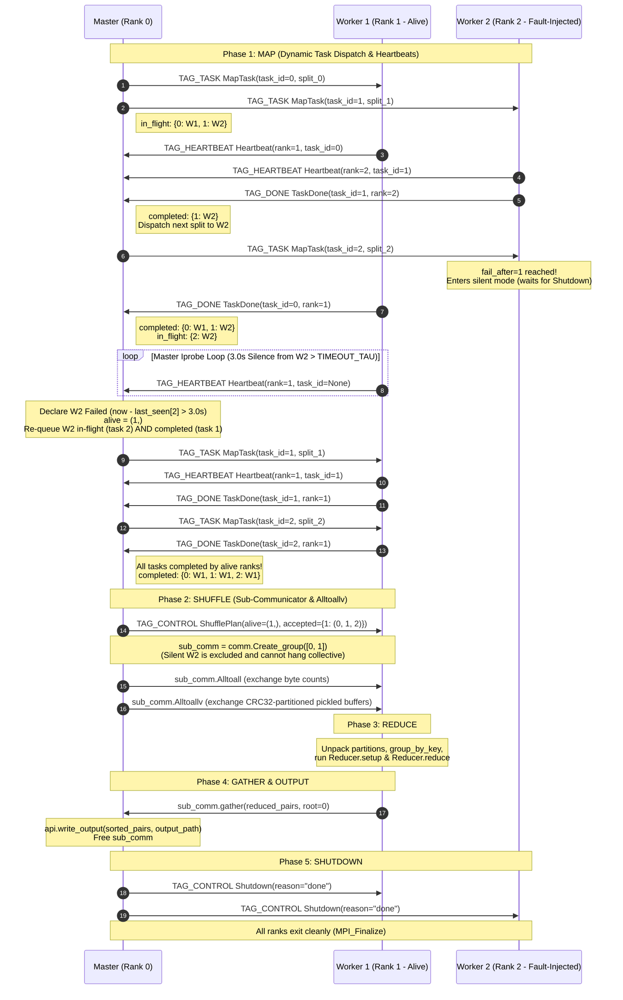

# Master/Worker MPI Protocol Specification (`mapreduce.protocol`)

This document specifies the frozen Stage 1 communication, fault-detection, and collective shuffle protocol (`mapreduce/protocol.py`) between the Master process (**Rank 0**) and Worker processes (**Ranks `1 .. N-1`**) over `MPI.COMM_WORLD`.

---

## 1. Execution & Transport Model

- **Process Topology**: `MASTER = 0` coordinates scheduling, liveness monitoring, and final output writing. Ranks `1 .. N-1` are workers ($p = N - 1 \in \{1, 2, 4, 8\}$ for `mpiexec -n {2, 3, 5, 9}`).
- **Single-Threaded Event Loop (No Threads)**: Neither the master nor any worker spawns background threads.
  - Point-to-point control and task messages are pickled Python dataclass instances transmitted with `mpi4py`'s lowercase API (`comm.isend`, `comm.recv`) and polled non-blockingly on the master via `comm.Iprobe`.
  - Workers emit periodic heartbeats inline from within their map record-processing loop.
- **Dynamic Collective Sub-Communicator**: Bulk intermediate data exchange (Shuffle) and result collection (Gather) execute over a dynamically constructed sub-communicator (`comm.Create_group`) containing only `MASTER` and surviving (`alive`) workers, preventing a silent/failed worker from deadlocking collective calls.

---

## 2. MPI Tags and Constants

| Constant | Value | Direction | Purpose |
| :--- | :--- | :--- | :--- |
| `MASTER` | `0` | — | World rank of the master coordinator process. |
| `TAG_TASK` | `1` | Master $\to$ Worker | Dispatches a `MapTask` assignment to an idle worker. |
| `TAG_DONE` | `2` | Worker $\to$ Master | Delivers a `TaskDone` completion acknowledgment and task metrics. |
| `TAG_HEARTBEAT` | `3` | Worker $\to$ Master | Delivers a periodic `Heartbeat` liveness pulse during Map execution. |
| `TAG_CONTROL` | `4` | Master $\to$ Worker | Broadcasts phase transitions (`ShufflePlan`) and termination (`Shutdown`). |
| `HEARTBEAT_INTERVAL` | `0.5` s | Worker timer | Target elapsed interval between consecutive worker heartbeats. |
| `TIMEOUT_TAU` ($\tau$) | `3.0` s | Master timer | Maximum silence duration ($6 \times \text{HEARTBEAT\_INTERVAL}$) before a worker is declared failed. |

---

## 3. Message Types

All point-to-point messages are immutable (`@dataclass(frozen=True)`) objects defined in `mapreduce/protocol.py`:

### `MapTask` (`TAG_TASK`)
```python
@dataclass(frozen=True)
class MapTask:
    task_id: int
    split: InputSplit
```
Dispatched by the master to assign one `InputSplit` (`split_id`, `path`, `start`, `end`) identified by `task_id`.

### `TaskDone` (`TAG_DONE`)
```python
@dataclass(frozen=True)
class TaskDone:
    task_id: int
    rank: int
    records_in: int
    pairs_out: int
    compute_seconds: float
```
Sent by worker `rank` upon completing `task_id` (after running `Mapper` and optional map-side `Combiner`). Reports the number of input lines read (`records_in`), intermediate pairs retained after combining (`pairs_out`), and pure user-code computation time (`compute_seconds`). Note that the intermediate pairs themselves are **not** sent to the master; they remain in the worker's local memory indexed by `task_id` until the Shuffle phase.

### `Heartbeat` (`TAG_HEARTBEAT`)
```python
@dataclass(frozen=True)
class Heartbeat:
    rank: int
    task_id: Optional[int]
    sent_at: float
```
Sent periodically every `HEARTBEAT_INTERVAL` (`0.5` s) by worker `rank` while processing `task_id`, carrying a wall-clock timestamp `sent_at`.

### `ShufflePlan` (`TAG_CONTROL`)
```python
@dataclass(frozen=True)
class ShufflePlan:
    alive: Tuple[int, ...]
    accepted: Dict[int, Tuple[int, ...]] = field(default_factory=dict)
```
Sent by the master to each surviving worker when all map tasks have been completed:
- **`alive`**: Sorted tuple of `MPI.COMM_WORLD` ranks of all surviving workers (e.g., `(1, 2, 3, 4)`). The number of reduce partitions is $R = |\text{alive}|$.
- **`accepted`**: Maps each surviving worker `rank` to the exact tuple of `task_id`s whose map outputs that worker must contribute to the shuffle. If a task was re-dispatched after a timeout, only the authoritative accepted execution is listed in `accepted`, guaranteeing exactly-once contribution.

### `Shutdown` (`TAG_CONTROL`)
```python
@dataclass(frozen=True)
class Shutdown:
    reason: str = "done"
```
Sent by the master over `MPI.COMM_WORLD` to **all** worker ranks (`1 .. N-1`, including fault-injected silent ranks) at job completion so every rank exits cleanly.

---

## 4. Phase Sequence

Execution proceeds strictly through five sequential phases:

### Phase 1: MAP (Dynamic Task Queue & Liveness Polling)
1. **Split Generation**: Master calls `mapreduce.splitter.make_splits(input_paths, split_size)` and populates a pending queue of `MapTask(task_id=split.split_id, split=split)`.
2. **Initial Dispatch**: Master dispatches one `MapTask` (`TAG_TASK` via `comm.isend`) to each available worker rank `1 .. N-1` and records the assignment in its **in-flight ledger**.
3. **Worker Map & Local Combine**:
   - Upon receiving `MapTask`, the worker reads owned lines via `read_split(task.split)`, calling `Mapper.setup`, `Mapper.map`, and `Mapper.cleanup`.
   - Between records, whenever `perf_counter() - last_hb >= HEARTBEAT_INTERVAL`, the worker non-blockingly sends `Heartbeat(rank, task_id, now)` (`TAG_HEARTBEAT`) to `MASTER`.
   - After reading the split, if the job defines a `Combiner` (and `--no-combiner` is not set), the worker runs `api.run_reducer(job.combiner(), raw_pairs, ctx)` to pre-aggregate pairs in memory.
   - The worker stores the resulting pairs in `local_outputs[task_id]` and sends `TaskDone` (`TAG_DONE`) to `MASTER`.
4. **Master Event Loop**:
   - Master continuously probes `MPI.COMM_WORLD` with `comm.Iprobe(source=MPI.ANY_SOURCE, tag=MPI.ANY_TAG, status=status)`.
   - On `TAG_HEARTBEAT`: updates `last_seen[rank] = now`.
   - On `TAG_DONE`: updates `last_seen[rank] = now`, moves `task_id` from the **in-flight ledger** to the **completed ledger**, and dispatches the next pending `MapTask` to `rank` if the queue is non-empty.
   - Evaluates worker timeouts against `TIMEOUT_TAU` ($\tau = 3.0\text{ s}$, adjustable via `--timeout`).

### Phase 2: SHUFFLE (`Create_group` + `Alltoallv`)
1. **Plan Broadcast**: Once `len(completed) == total_tasks` and `in_flight` is empty, the master sends `ShufflePlan(alive=tuple(sorted(alive_workers)), accepted=...)` (`TAG_CONTROL`) to every rank in `alive`.
2. **Sub-Communicator Creation (`Create_group`)**:
   - Master and every worker in `ShufflePlan.alive` build the surviving rank list `group_ranks = [MASTER, *plan.alive]`.
   - Each participating rank extracts the world group `world_group = comm.Get_group()`, forms `sub_group = world_group.Incl(group_ranks)`, and creates `sub_comm = comm.Create_group(sub_group)`.
   - Because `MPI.Intracomm.Create_group` is collective **only over the ranks in `sub_group`**, any silent fault-injected worker outside `plan.alive` is excluded without hanging the communicator creation.
   - In `sub_comm`, the master is rank `0` and surviving worker `plan.alive[r]` ($r \in \{0, \dots, R-1\}$) has sub-communicator rank `r + 1`.
3. **Hash Partitioning & Serialization**:
   - Each surviving worker collects its retained map outputs for `task_id in plan.accepted[my_world_rank]`.
   - For each pair `(key, value)`, the worker computes the target partition index `r = api.partition(key, R)` ($R = |\text{plan.alive}|$), which corresponds to `sub_comm` destination rank `r + 1`.
   - Each of the $R$ partition buckets is serialized with `pickle.dumps` into a `bytes` buffer; the byte length aimed at `sub_comm` rank `0` (`MASTER`) is `0`.
   - `MASTER` prepares empty `0`-byte send buffers for all `R + 1` members of `sub_comm`.
4. **All-to-All Buffer Exchange (`Alltoall` + `Alltoallv`)**:
   - All members of `sub_comm` first exchange integer byte counts (`sendcounts` $\to$ `recvcounts`) via `sub_comm.alltoall` (or `sub_comm.Alltoall`).
   - Send and receive byte displacement arrays (`sdispls`, `rdispls`) are computed from the prefix sums of `sendcounts` and `recvcounts`.
   - Participating ranks execute `sub_comm.Alltoallv([sendbuf, sendcounts, sdispls, MPI.BYTE], [recvbuf, recvcounts, rdispls, MPI.BYTE])` to exchange all intermediate partitions in a single collective operation.

### Phase 3: REDUCE
- Each surviving worker $r \in \{0, \dots, R-1\}$ (`sub_comm` rank $r + 1$) unpacks the $R$ pickled slices from its `recvbuf`, concatenates all intermediate `(key, value)` pairs belonging to partition $r$, and runs:
  ```python
  reduced_pairs = api.run_reducer(job.reducer(), partition_pairs, ctx)
  ```
- Since `api.partition(key, R)` maps every occurrence of `key` across all mappers to the exact same partition $r$, each unique key is reduced completely on a single worker.

### Phase 4: GATHER & OUTPUT
- The reduced `(key, value)` lists from all $R$ surviving workers are gathered to `MASTER` (rank `0` in `sub_comm`) via `sub_comm.gather(reduced_pairs, root=0)`.
- `MASTER` concatenates the gathered partition lists, writes the globally key-sorted TSV output file using `api.write_output(all_pairs, output_path)`, and frees `sub_comm` and `sub_group`.

### Phase 5: SHUTDOWN (STOP)
- `MASTER` sends `Shutdown(reason="done")` with `TAG_CONTROL` over `MPI.COMM_WORLD` to **every worker rank `1 .. N-1`**—both the surviving workers and any silent fault-injected workers that were excluded from `sub_comm`.
- All ranks receive `Shutdown`, exit their worker loops, and reach `MPI_Finalize` cleanly.

---

## 5. Ledgers, Timeout $\tau$, and Re-Dispatch Rules

To guarantee resilience against worker loss in an **in-memory** MapReduce engine, the master maintains two task ledgers and a liveness table:

| State Structure | Schema | Description |
| :--- | :--- | :--- |
| **`pending_queue`** | ` deque[MapTask]` | Unassigned map tasks waiting for an available alive worker. |
| **`in_flight` Ledger** | `dict[int, tuple[int, float]]` | Maps `task_id -> (worker_rank, dispatch_time)` for tasks currently executing on a worker. |
| **`completed` Ledger** | `dict[int, int]` | Maps `task_id -> worker_rank` for tasks acknowledged via `TaskDone` whose intermediate output resides in `worker_rank`'s RAM. |
| **`last_seen` Table** | `dict[int, float]` | Maps `worker_rank -> last_contact_timestamp` (updated on every `Heartbeat` or `TaskDone`). |

### Timeout Detection and Dual-Ledger Re-Dispatch Rule
During the Map phase, the master checks `now - last_seen[w] > TIMEOUT_TAU` ($\tau = 3.0\text{ s}$) for every worker `w in alive_workers`. When worker `w` exceeds $\tau$:

1. **Worker Exclusion**: `w` is removed from `alive_workers` and appended to `failed_ranks`.
2. **In-Flight Task Re-Queueing**: Every `task_id` in `in_flight` assigned to `w` is deleted from `in_flight` and pushed back onto `pending_queue`.
3. **Completed Task Re-Queueing (In-Memory Map Output Rule)**: Every `task_id` in `completed` credited to `w` is **also** deleted from `completed` and pushed back onto `pending_queue`.
   - *Rationale*: Unlike disk-backed frameworks that spill map outputs to a distributed filesystem, this lightweight framework stores intermediate map outputs exclusively in the worker's virtual memory until the `Alltoallv` shuffle. When worker `w` becomes unresponsive prior to Shuffle, all map outputs stored in `w`'s memory are lost and must be recomputed by surviving workers.
4. **Duplicate Suppression via `ShufflePlan.accepted`**: Once all tasks are re-executed and acknowledged by surviving workers, `ShufflePlan.accepted[rank]` is populated directly from the final `completed` ledger (`{w: tuple(sorted(tid for tid, owner in completed.items() if owner == w))}`). Even if a late `TaskDone` arrived before exclusion, only the authoritative owner in `completed` contributes each `task_id` to the shuffle.

---

## 6. Fault-Injection Semantics

As noted in Section 3 of the project proposal, standard MPI runtimes (Intel MPI, OpenMPI, MPICH) default to `MPI_ERRORS_ARE_FATAL` on `MPI_COMM_WORLD`: if a rank terminates abnormally (e.g., `sys.exit(1)` or `SIGKILL`), `mpiexec` immediately aborts the entire job across all ranks.

To deterministically test and benchmark master timeout detection, dual-ledger task re-dispatch, and `Create_group` sub-communicator recovery:
- `mr_driver.py` accepts `--fail-rank R` and `--fail-after K` (default $K = 1$).
- Worker rank `R` executes normally for its first `K` assigned map tasks, sending heartbeats and `TaskDone` acknowledgments.
- Upon completing its $K$-th task (or receiving its $(K+1)$-th task when $K$ tasks are done), rank `R` enters **simulated failure (silent mode)**:
  - It stops sending `Heartbeat` and `TaskDone` messages.
  - It ignores any further `TAG_TASK` messages.
  - It blocks in a receive loop waiting exclusively for a `Shutdown` message on `TAG_CONTROL` from `MASTER`, then exits cleanly.

---

## 7. Protocol Sequence Diagram

The following Mermaid sequence diagram illustrates a complete execution with $N = 3$ ranks (`Master` at rank 0, `Worker 1` at rank 1, and fault-injected `Worker 2` at rank 2 with `--fail-rank 2 --fail-after 1`):


