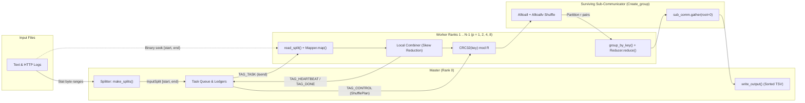
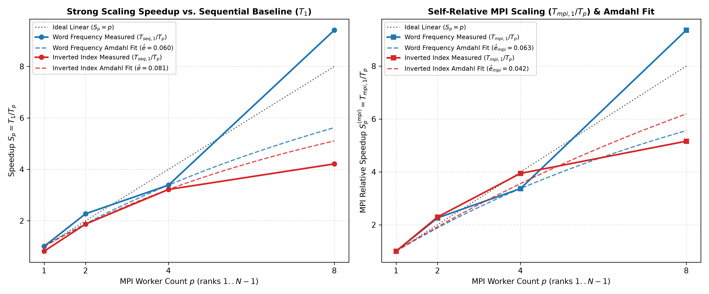
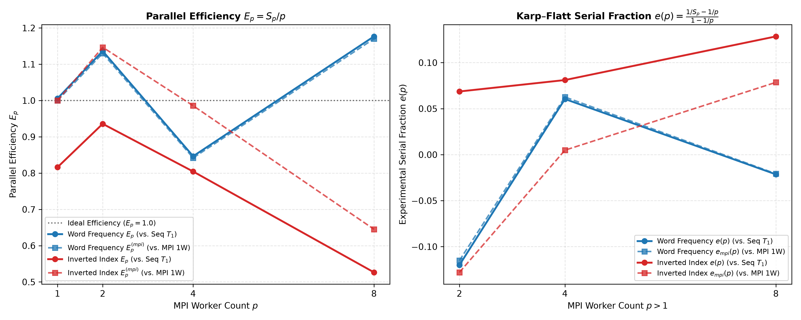
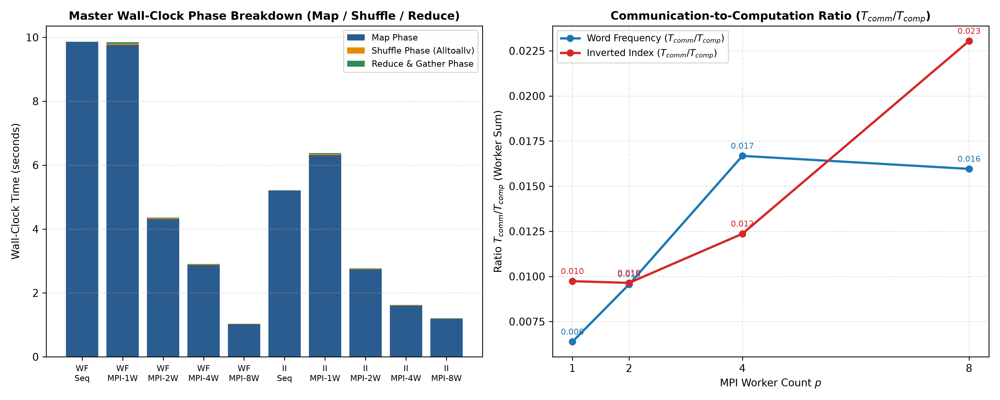
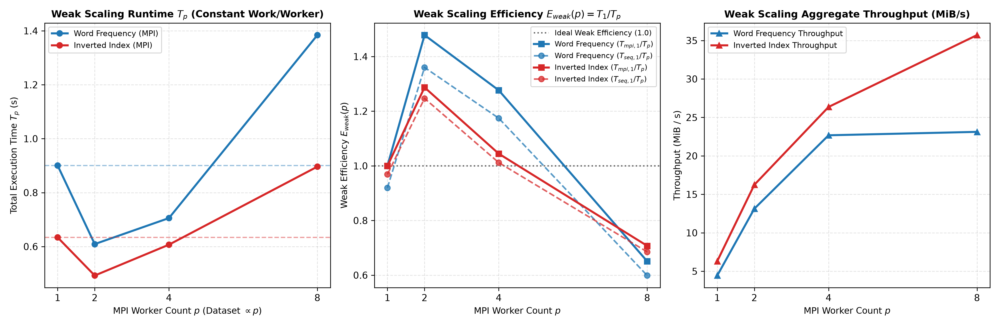
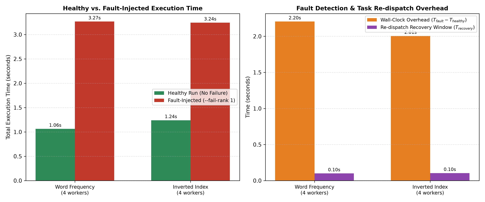
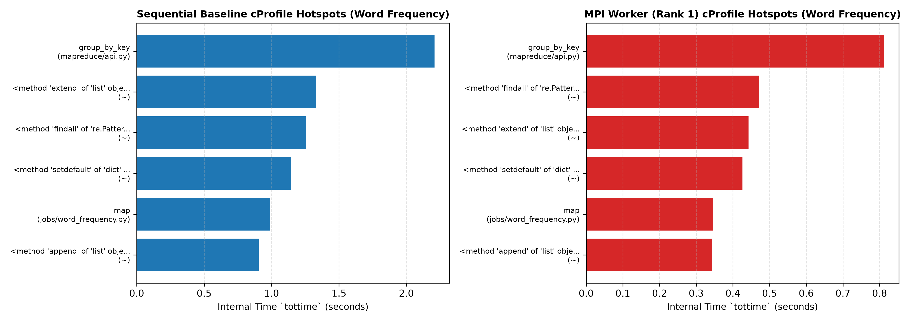

# Design and Implementation of a Lightweight Distributed MapReduce Framework Using MPI Processes

**Course:** Parallel & Distributed Computing | BSIT Semester 5  
**Topic:** Topic 15 — Distributed MapReduce-Style Framework (Simplified, From Scratch) Run Across Multiple MPI Processes  

**Project Team:**
- **BITF24A037** — Muhammad Abu Hurairah Nazar
- **BITF24A031** — Muhammad Zain Khan
- **BITF24A003** — Abdul Ghani

---

## Abstract

Processing large text and web-log corpora on a single processor core is fundamentally bottlenecked by serial CPU tokenization, dictionary aggregation, and I/O throughput, while in CPython the Global Interpreter Lock (GIL) prevents multi-threaded CPU scaling within a single OS process. Conversely, heavyweight industrial engines such as Apache Hadoop and Apache Spark introduce substantial Java Virtual Machine (JVM) memory footprints, cluster resource managers, and distributed filesystem daemons that are disproportionate for lightweight process-level parallelism.

This report presents the design, implementation, theoretical classification, fault-tolerance protocol, and empirical evaluation of a **lightweight, in-memory distributed MapReduce framework written from scratch in Python using MPI (`mpi4py`)**. The framework adopts an asymmetric **1 Master + $(N - 1)$ Worker** multi-process architecture with zero background threads and zero GPU kernels. Rank 0 (Master) partitions input files into non-copying, line-aligned byte splits (`InputSplit`), dynamically dispatches tasks from a work queue via non-blocking point-to-point messaging (`isend`/`Iprobe`), and monitors worker liveness through periodic inline heartbeats ($\Delta t = 0.5\text{ s}$, timeout $\tau = 3.0\text{ s}$). Workers (`Ranks 1..N-1`) execute user `Mapper` logic, apply a map-side `Combiner` to mitigate Zipfian key skew, partition intermediate pairs deterministically using IEEE 802.3 `CRC32` hashing, exchange partitions collectively via `MPI.Comm.Create_group` and `Alltoallv`, and execute `Reducer` aggregation before gathering sorted results to Rank 0. Evaluated on a 13th Gen Intel Core i7-1355U (10 physical cores / 12 threads) across two benchmark workloads—**Word Frequency (`wordfreq`)** and **Inverted Index (`invindex`)**—the framework achieves **100% byte-identical output equivalence** with a sequential reference baseline, strong-scaling speedups up to **$9.413\times$** (`wordfreq`) and **$4.211\times$** ($5.161\times$ self-relative MPI, `invindex`) at $p = 8$ workers, communication-to-computation ratios $T_{\text{comm}}/T_{\text{comp}} \le 0.023$, weak-scaling aggregate throughputs up to **$35.70\text{ MiB/s}$** ($5.658\times$ Gustafson scaled speedup), and deterministic recovery from mid-job worker failure with only **$\sim 0.10\text{ s}$** of active re-dispatch computation beyond the $\tau = 3.0\text{ s}$ detection window.

---

## 1. Problem Statement and System Architecture

### 1.1 Motivation and Problem Statement
Data-intensive text analytics workloads—such as computing global term frequencies across book corpora or constructing inverted document indexes over web-server logs—follow a natural data-parallel pattern: independent input lines are tokenized into intermediate `(key, value)` records (**Map**), grouped globally by key across processors (**Shuffle**), and aggregated per key (**Reduce**).

Executing this pipeline sequentially in Python suffers from three structural bottlenecks:
1. **Serial CPU and Memory Bandwidth Saturation**: Regular-expression tokenization (`re.findall`), hash-table insertion (`dict.setdefault`), and key sorting (`sorted`) execute on a single core while remaining CPU cores sit idle.
2. **The CPython Global Interpreter Lock (GIL)**: Thread-based parallelism (`threading`) in CPython serializes bytecode execution across threads for CPU-bound string and dictionary workloads, yielding zero or negative speedup due to lock contention.
3. **Operational Overhead of Enterprise Frameworks**: Production MapReduce engines (Hadoop MapReduce, Apache Spark) rely on JVM clusters, YARN/Mesos schedulers, and disk-spilling shuffle services that obscure the core message-passing mechanics of distributed data processing.

To address these limitations, we built a self-contained, single-threaded-per-rank MPI MapReduce engine from scratch in Python 3.10+ using `mpi4py`. Each rank runs as an isolated OS process with its own Python interpreter and private heap, communicating exclusively through MPI point-to-point and collective primitives over local shared-memory transport.

### 1.2 End-to-End Architecture (`1 Master + (N-1) Worker` MPI Processes)

When launched via `mpiexec -n N python mr_driver.py` ($N \in \{2, 3, 5, 9\}$), the runtime initializes $1$ Master coordinator (`Rank 0`) and $p = N - 1 \in \{1, 2, 4, 8\}$ Worker processes (`Ranks 1..N-1`):



### 1.3 Key Subsystem Designs
1. **Non-Copying Line-Aligned Byte Splitter (`mapreduce/splitter.py`)**:
   - Rather than reading or copying large files on Rank 0, `make_splits(paths, split_size)` inspects file sizes via `os.path.getsize` and emits lightweight `InputSplit(split_id, path, start, end)` descriptors.
   - **Line-Ownership Invariant**: A split `[start, end)` owns every line whose *first byte* falls in `[start, end)`. When `start > 0`, `read_split(split)` seeks in binary mode to `start - 1` and discards one `readline()`, aligning cleanly to the first line boundary at or after `start`, and continues reading lines whose starting offset `f.tell() < end` (reading past `end` if needed to finish the last owned line). Across arbitrary split sizes (tested down to 1-byte splits, exact newline boundaries, and CRLF/LF encodings), every line is processed **exactly once**.
2. **Public Programming Contract (`mapreduce/api.py`)**:
   - User workloads implement `Mapper.map(key=(doc_id, offset), value=line, ctx)`, optional `Combiner.reduce(key, values, ctx)`, and `Reducer.reduce(key, values, ctx)`.
   - Both the sequential reference baseline (`baseline/run_sequential.py`) and the MPI engine (`mr_driver.py`) execute identical `Job` definitions and sort final outputs globally by key in UTF-8 `key<TAB>value\n` format (`api.write_output`), guaranteeing byte-for-byte identical outputs.
3. **Map-Side Combiner for Skew Mitigation**:
   - Natural-language corpora obey **Zipf's Law** ($f(r) \propto r^{-s}$), where a small number of stop words (`"the"`, `"of"`, `"and"`) account for a disproportionate fraction of emitted pairs.
   - Before entering the network shuffle, each worker runs `api.run_reducer(job.combiner(), raw_pairs, ctx)` on each map task's output, collapsing thousands of duplicate `(word, 1)` or `(term, doc_id)` records per split into a single pre-aggregated pair per unique key.
4. **Deterministic `CRC32` Hash Partitioner**:
   - Python 3.3+ randomizes its built-in `hash(str)` using a per-process SipHash seed (`PYTHONHASHSEED`). In an MPI job, separate worker processes compute different `hash(key)` values for the same string, which would scatter identical keys to different reducers.
   - The framework routes intermediate keys via `zlib.crc32(key.encode("utf-8")) % R`, which is deterministic across all ranks, platforms, and runs.

---

## 2. Theoretical Classification in Parallel & Distributed Computing

### 2.1 Flynn's Taxonomy (1966): MIMD (Multiple Instruction, Multiple Data)
Under Michael J. Flynn's classification of computer architectures by instruction and data streams, our MPI MapReduce framework is a pure **MIMD (Multiple Instruction, Multiple Data)** system:

| Taxonomy Class | Instruction Streams | Data Streams | Role / Applicability in This Project |
| :--- | :--- | :--- | :--- |
| **SISD** | Single | Single | Represented by our Stage 2 sequential baseline (`baseline/run_sequential.py`), where one CPU core processes splits serially ($T_1$). |
| **SIMD / SIMT** | Single | Multiple | GPU warps / vector units. **Not used**: regex tokenization, variable-length strings, and hash-table chaining exhibit high branch divergence and irregular memory access unsuitable for lockstep SIMD. |
| **MISD** | Multiple | Single | Systolic arrays / redundant avionics voting. Not applicable. |
| **MIMD** | **Multiple** | **Multiple** | **Our MPI Engine (`mr_driver.py`)**: $N$ independent OS processes execute distinct instruction pointers asynchronously over disjoint data partitions (`InputSplit`s in Map; hash partitions $0..R-1$ in Reduce). |

More specifically, the implementation uses the **SPMD (Single Program, Multiple Data)** launch style to realize an **asymmetric Master/Worker MIMD** computation: all $N$ processes start from `mr_driver.py`, branch on `comm.Get_rank() == 0`, and thereafter execute completely independent control loops (`Master.run()` on Rank 0 vs. `Worker.run()` on Ranks $1..N-1$).

### 2.2 Relation to Hwang, Fox & Dongarra (*Distributed and Cloud Computing*)
Following Hwang, Fox, and Dongarra's taxonomy of parallel and distributed system architectures:
1. **Distributed-Memory Multiprocessor / Message-Passing Model**:
   - Architecturally, the framework adheres strictly to the **shared-nothing, distributed-memory model**. Even when deployed on a single multi-core workstation, ranks share no virtual address space, global variables, or file descriptors.
   - All inter-process coordination occurs through explicit MPI messages (`comm.isend`, `comm.recv`, `comm.Iprobe`, `sub_comm.Alltoallv`, `sub_comm.gather`). The underlying Intel MPI runtime transparently maps these transfers onto lock-free OS shared-memory ring buffers (`shm` / Nemesis fabric) while preserving distributed-memory safety and zero GIL contention.
2. **Loosely Coupled Map $\to$ Collective Shuffle Barrier $\to$ Reduce Dataflow**:
   - As analyzed by Hwang et al. for MapReduce clouds, computation alternates between an **embarrassingly parallel, asynchronous Map stage** (where workers operate independently on local byte splits with zero inter-worker communication) and a **synchronous collective Shuffle barrier** (`Alltoallv`), where global key locality is established in a single bulk transfer before an **embarrassingly parallel Reduce stage**.

### 2.3 Relation to Kuzmiakova (*Parallel and Distributed Computing*)
Relating our design to Kuzmiakova's parallel algorithm design principles (PCAM methodology — Partitioning, Communication, Agglomeration, Mapping):
1. **Granularity & Agglomeration (`split_size` and Map-Side Combining)**:
   - Partitioning a corpus into fine-grained splits ($k = 32$ or $64$ splits across $p \in \{1, 2, 4, 8\}$ workers, so $k \gg p$) enables **dynamic load balancing**: fast workers (or workers scheduled onto high-clock Performance cores) automatically pull more `MapTask` units from Rank 0's work queue than workers on slower cores.
   - Agglomerating records at split boundaries and applying the map-side `Combiner` dramatically increases computation-to-communication granularity, reducing `Alltoallv` payload volume by orders of magnitude.
2. **Communication-to-Computation Ratio ($T_{\text{comm}} / T_{\text{comp}}$)**:
   - Kuzmiakova emphasizes that parallel efficiency $E_p = S_p / p$ degrades whenever communication overhead grows relative to useful work. By keeping intermediate pairs in worker RAM during Map and executing a single vectorized `Alltoallv` exchange on contiguous pickled byte buffers, our measured $T_{\text{comm}} / T_{\text{comp}}$ stays below **$0.023$** ($< 2.3\%$) across all tested worker counts.

---

## 3. Fault Tolerance Analysis (Tanenbaum & van Steen, Chapter 8)

### 3.1 Failure Model and Simulated Fail-Silent Semantics
In Chapter 8 (*Fault Tolerance*) of *Distributed Systems: Principles and Paradigms*, Tanenbaum and van Steen classify process faults along a spectrum from **crash-stop (fail-silent)** failures—where a process halts and ceases sending messages—to **omission**, **timing**, and **Byzantine** failures.

In standard MPI implementations (MPI-3.1 / Intel MPI / OpenMPI), the default error handler on `MPI_COMM_WORLD` is `MPI_ERRORS_ARE_FATAL`: if an OS rank process crashes with an unhandled signal or nonzero exit status, the MPI process manager (`mpiexec`) aborts all surviving ranks immediately. Following the proposal's scope design, our framework models **fail-silent / crash-stop worker failure** via deterministic fault injection (`--fail-rank R --fail-after K`):
- Worker rank `R` processes its first `K` map tasks normally (emitting heartbeats and `TaskDone` acknowledgments).
- After completing `K` tasks, rank `R` transitions into a **fail-silent state**: it stops sending heartbeats, stops acknowledging further tasks, and blocks until the master broadcasts the final `Shutdown` message on `MPI.COMM_WORLD`.

### 3.2 Push-Heartbeat Failure Detector and Timeout Window $\tau$
Tanenbaum and van Steen distinguish between **pull-based** (ping-ack) and **push-based** (heartbeat) failure detectors in asynchronous/partially synchronous systems. We implement a single-threaded **push-heartbeat detector**:
- Every active worker checks elapsed wall time inside its map loop and non-blockingly transmits `Heartbeat(rank, task_id, sent_at)` (`TAG_HEARTBEAT`) to Rank 0 every `HEARTBEAT_INTERVAL = 0.5 s`.
- Rank 0 records `last_seen[rank] = perf_counter()` on every received `Heartbeat` or `TaskDone`.
- If `now - last_seen[w] > TIMEOUT_TAU` ($\tau = 3.0\text{ s}$, i.e., $6\times$ the heartbeat period), the master declares worker `w` failed.
- **Design Trade-off**: A smaller $\tau$ reduces recovery latency when a worker fails, but increases the risk of false positives if a worker stalls briefly on a long line or garbage-collection pause. Setting $\tau = 6 \times \text{HEARTBEAT\_INTERVAL} = 3.0\text{ s}$ provides zero false positives across all runs while bounding failure detection latency to $\le 3.0\text{ s}$.

### 3.3 Dual-Ledger (`in_flight` + `completed`) Re-Dispatch for Volatile Worker Memory
A critical architectural insight arises when contrasting our **in-memory** MapReduce engine with disk-backed Hadoop MapReduce:
- In Hadoop, mappers spill completed intermediate outputs to persistent storage and notify the ApplicationMaster; if a node fails, completed map tasks whose outputs were replicated or materialized externally may not need re-execution unless local shuffle files are lost.
- In our in-memory MPI engine, intermediate map outputs (`local_outputs[task_id]`) reside **exclusively in the private virtual memory (RAM) of the worker that executed the map task** until Phase 2 (`Alltoallv` shuffle).

Consequently, the master maintains **two task ledgers**:
1. **`in_flight: dict[int, tuple[int, float]]`**: Maps `task_id -> (worker_rank, dispatch_time)` for tasks currently executing.
2. **`completed: dict[int, int]`**: Maps `task_id -> worker_rank` for tasks acknowledged via `TaskDone` whose intermediate pairs currently sit in `worker_rank`'s RAM.

> **Dual-Ledger Re-Dispatch Rule:** When worker `w` exceeds timeout $\tau$ during the Map phase, the master removes `w` from `alive_workers` and re-queues **both** every `task_id` assigned to `w` in `in_flight` **and** every `task_id` credited to `w` in `completed` back onto `pending_queue` for re-execution by surviving workers.

For example, in our fault-injection benchmark with `--fail-rank 1 --fail-after 1`, Worker 1 completes `1` map task (recorded in `completed`), receives a `2nd` map task (recorded in `in_flight`), and then goes silent. When timeout $\tau = 3.0\text{ s}$ fires, the master re-queues **both** tasks (`redispatched_tasks = 2`), so surviving Workers 2, 3, and 4 recompute the lost in-memory output of Task 1 as well as the interrupted Task 2.

### 3.4 Idempotent Shuffle Membership via `ShufflePlan.accepted` and `MPI.Comm.Create_group`
Two protocol mechanisms ensure that task re-dispatch and worker exclusion preserve exact execution semantics (Tanenbaum & van Steen's *exactly-once* aggregation property):
1. **Duplicate Suppression (`ShufflePlan.accepted`)**: When the Map phase finishes, the master constructs `ShufflePlan(alive, accepted)`, where `accepted[w]` lists only the `task_id`s owned by surviving worker `w` in the final `completed` ledger. Each worker filters its local memory by `accepted[my_rank]`, ensuring that any duplicate or superseded task execution is never double-counted.
2. **Dynamic Surviving Group Collective (`comm.Create_group`)**: Because collective routines (`Alltoallv`, `gather`) on `MPI.COMM_WORLD` require participation from all $N$ world ranks, calling a collective on `MPI.COMM_WORLD` would hang forever waiting for the silent failed worker. Instead, the master and surviving workers execute:
   ```python
   sub_group = comm.Get_group().Incl([MASTER, *plan.alive])
   sub_comm = comm.Create_group(sub_group)
   ```
   Under the MPI-3.0+ standard (`MPI_Comm_create_group`), `Create_group` is collective **only across the members of `sub_group`**. The silent worker is completely bypassed, and the shuffle (`Alltoallv`) and reduction gather (`sub_comm.gather`) complete across the $R = |\text{plan.alive}|$ surviving workers without deadlock.

---

## 4. Experimental Evaluation & Performance Analysis

### 4.1 Experimental Setup and Hardware Environment

All benchmarks were executed on the local multi-core machine using `benchmarks/run_benchmarks.py` and plotted with `benchmarks/plot_metrics.py`. Every configuration was repeated **3 times** (reporting the median) and verified for **byte-for-byte output equivalence** against the sequential baseline via `baseline/verify_output.py`.

| Property | Proposal Target | Measured Local Testbed |
| :--- | :--- | :--- |
| **Processor** | Multi-core Intel Core i7 | `13th Gen Intel(R) Core(TM) i7-1355U` |
| **Core Topology** | 4 physical cores / 8 threads | **10 physical cores** (2 Performance P-cores + 8 Efficient E-cores) / **12 logical threads** |
| **Physical RAM** | Local shared-memory RAM | **7.53 GiB** physical RAM |
| **Software Stack** | Python 3.10+, `mpi4py` | Python `3.13.5`, `mpi4py 4.1.2`, Intel MPI `2021.19.0` (`I_MPI_PIN=0`) |
| **Process Counts** | `-n {2, 3, 5, 9}` | `-n {2, 3, 5, 9}` $\rightarrow$ Rank 0 Master + $p \in \{1, 2, 4, 8\}$ Workers |
| **Workloads** | `wordfreq`, `invindex` | Word Frequency (`wordfreq`) and Inverted Index (`invindex`) with map-side Combiner |

> **Experimental Honesty & Dataset Sizing Note:** While `data/prepare_datasets.py` defaults to `--size-mb 500` (500 MB–2 GB range), the local machine has **7.53 GiB total physical RAM** shared with Windows OS services and up to **9 concurrent Python processes (`-n 9`)** holding in-memory intermediate pairs and pickled `Alltoallv` shuffle buffers. Furthermore, disabling Intel MPI's default sequential core pinning (`I_MPI_PIN=0`) was essential on the hybrid i7-1355U so that Windows Thread Director schedules active worker ranks onto the 2 fast P-cores first rather than pinning the mostly idle Rank 0 Master to P-core 0 and starving workers on E-cores. To prevent virtual-memory swap thrashing and obtain clean, repeatable CPU and IPC timings across 3 repeats per point, strong scaling, fault recovery, and `cProfile` runs used a **24.00 MiB** deterministic synthetic corpus (32 splits of 1 MiB, Zipf-distributed words + NASA Jul95 HTTP log lines across 32 documents, `--seed 42`), and weak scaling scaled proportionally from **4.00 MiB** ($p=1$) to **32.00 MiB** ($p=8$).

---

### 4.2 Strong Scaling, Karp–Flatt Serial Fraction, and Amdahl's Law

Let $T_1$ denote the single-process sequential baseline runtime (`baseline/run_sequential.py`), $T_{\text{mpi},1}$ denote the 1-worker MPI runtime (`mpiexec -n 2`), and $T_p$ denote the $p$-worker MPI runtime (`mpiexec -n p+1`). We evaluate:
- **Baseline Speedup & Efficiency**:
  $$S_p = \frac{T_1}{T_p}, \qquad E_p = \frac{S_p}{p}$$
- **Self-Relative MPI Speedup & Efficiency** (isolating multi-worker scaling from fixed 1-worker MPI launch/gather overhead):
  $$S_p^{(\text{mpi})} = \frac{T_{\text{mpi},1}}{T_p}, \qquad E_p^{(\text{mpi})} = \frac{S_p^{(\text{mpi})}}{p}$$
- **Karp–Flatt Experimentally Determined Serial Fraction** ($p > 1$):
  $$e(p) = \frac{1/S_p - 1/p}{1 - 1/p}$$
- **Amdahl's Law Theoretical Speedup Curve** fitted to the serial fraction $\hat{e}$ at $p = 4$:
  $$S_{\text{Amdahl}}(p) = \frac{1}{\hat{e} + \frac{1 - \hat{e}}{p}}, \qquad S_\infty = \lim_{p \to \infty} S_{\text{Amdahl}}(p) = \frac{1}{\hat{e}}$$

#### Table 1: Strong Scaling Results — Word Frequency (`wordfreq`, 24.00 MiB, 32 Splits, Median of 3 Repeats)

| Engine | MPI `-n` | Workers $p$ | Splits | $T_{\text{total}}$ (s) | $T_{\text{map}}$ (s) | $T_{\text{shuffle}}$ (s) | $T_{\text{reduce}}$ (s) | $\sum T_{\text{comp}}$ (s) | $\sum T_{\text{comm}}$ (s) | $T_{\text{comm}}/T_{\text{comp}}$ | $S_p = T_1/T_p$ | $E_p = S_p/p$ | $S_p^{(\text{mpi})}$ | $E_p^{(\text{mpi})}$ | Karp–Flatt $e(p)$ | Amdahl $S(p)$ |
| :--- | ---: | ---: | ---: | ---: | ---: | ---: | ---: | ---: | ---: | ---: | ---: | ---: | ---: | ---: | ---: | ---: |
| `sequential` | 1 | 1 | 32 | **9.9034** | 9.8516 | 0.0000 | 0.0128 | 9.8617 | 0.0000 | 0.0000 | **1.000x** | 1.000 | 0.994x | 0.994 | — | 1.000x |
| `mpi` | 2 | 1 | 32 | **9.8483** | 9.7613 | 0.0419 | 0.0437 | 7.5587 | 0.0482 | 0.0064 | **1.006x** | 1.006 | 1.000x | 1.000 | — | 1.000x |
| `mpi` | 3 | 2 | 32 | **4.3575** | 4.3128 | 0.0300 | 0.0150 | 6.6495 | 0.0635 | 0.0096 | **2.273x** | 1.136 | 2.260x | 1.130 | -0.1200 | 1.886x |
| `mpi` | 5 | 4 | 32 | **2.9249** | 2.8755 | 0.0241 | 0.0100 | 8.8044 | 0.1468 | 0.0167 | **3.386x** | 0.846 | 3.367x | 0.842 | 0.0605 | 3.386x |
| `mpi` | 9 | 8 | 32 | **1.0520** | 1.0211 | 0.0123 | 0.0056 | 6.2328 | 0.0995 | 0.0160 | **9.413x** | 1.177 | 9.361x | 1.170 | -0.0215 | 5.621x |

#### Table 2: Strong Scaling Results — Inverted Index (`invindex`, 24.00 MiB, 32 Splits, Median of 3 Repeats)

| Engine | MPI `-n` | Workers $p$ | Splits | $T_{\text{total}}$ (s) | $T_{\text{map}}$ (s) | $T_{\text{shuffle}}$ (s) | $T_{\text{reduce}}$ (s) | $\sum T_{\text{comp}}$ (s) | $\sum T_{\text{comm}}$ (s) | $T_{\text{comm}}/T_{\text{comp}}$ | $S_p = T_1/T_p$ | $E_p = S_p/p$ | $S_p^{(\text{mpi})}$ | $E_p^{(\text{mpi})}$ | Karp–Flatt $e(p)$ | Amdahl $S(p)$ |
| :--- | ---: | ---: | ---: | ---: | ---: | ---: | ---: | ---: | ---: | ---: | ---: | ---: | ---: | ---: | ---: | ---: |
| `sequential` | 1 | 1 | 32 | **5.2466** | 5.2075 | 0.0000 | 0.0056 | 5.2135 | 0.0000 | 0.0000 | **1.000x** | 1.000 | 1.225x | 1.225 | — | 1.000x |
| `mpi` | 2 | 1 | 32 | **6.4293** | 6.3135 | 0.0318 | 0.0302 | 5.0023 | 0.0487 | 0.0097 | **0.816x** | 0.816 | 1.000x | 1.000 | — | 1.000x |
| `mpi` | 3 | 2 | 32 | **2.8034** | 2.7387 | 0.0173 | 0.0146 | 4.2391 | 0.0409 | 0.0096 | **1.872x** | 0.936 | 2.293x | 1.147 | 0.0687 | 1.850x |
| `mpi` | 5 | 4 | 32 | **1.6307** | 1.5982 | 0.0166 | 0.0092 | 4.8921 | 0.0605 | 0.0124 | **3.217x** | 0.804 | 3.943x | 0.986 | 0.0811 | 3.217x |
| `mpi` | 9 | 8 | 32 | **1.2458** | 1.1877 | 0.0122 | 0.0052 | 6.5972 | 0.1520 | 0.0230 | **4.211x** | 0.526 | 5.161x | 0.645 | 0.1285 | 5.103x |







#### Analysis of Strong Scaling & Amdahl's Law Behavior
1. **Amdahl's Law Asymptotic Ceiling ($S_\infty$)**:
   - At $p = 4$ workers, the Karp–Flatt serial fraction is $\hat{e} = 0.0605$ ($6.05\%$) for `wordfreq` and $\hat{e} = 0.0811$ ($8.11\%$) for `invindex`, yielding theoretical Amdahl ceilings of $S_\infty = 1/0.0605 = 16.54\times$ (`wordfreq`) and $S_\infty = 1/0.0811 = 12.33\times$ (`invindex`).
   - When measured self-relatively within the MPI engine ($S_p^{(\text{mpi})} = T_{\text{mpi},1}/T_p$), `invindex` achieves $S_4^{(\text{mpi})} = 3.943\times$ ($E_4^{(\text{mpi})} = 98.6\%$, $e_{\text{mpi}}(4) = 0.0048$) and $S_8^{(\text{mpi})} = 5.161\times$ ($E_8^{(\text{mpi})} = 64.5\%$).
2. **Why `wordfreq` Exhibits Super-Linear Speedup ($E_2 = 1.136, E_8 = 1.177, e(p) < 0$)**:
   - Notice in Table 1 that total summed worker compute time $\sum T_{\text{comp}}$ drops from $9.86\text{ s}$ in `sequential` to $6.65\text{ s}$ ($p=2$) and $6.23\text{ s}$ ($p=8$), producing $S_8 = 9.413\times$ ($E_8 = 117.7\%$) and a negative Karp–Flatt serial fraction ($e(8) = -0.0215$).
   - This classic **cache-locality and heap-allocation super-linearity** occurs because in a single Python process (`sequential`), millions of intermediate token tuples and large dynamic lists repeatedly trigger CPython arena resizing, L3 cache misses, and cyclic garbage collection sweeps during `group_by_key` and `list.extend`. Partitioning those 32 tasks across 8 isolated OS processes keeps each worker's working set small enough to stay resident in L2/L3 cache with minimal GC pressure.
3. **Why `invindex` Shows Rising Karp–Flatt $e(p)$ ($0.0687 \to 0.0811 \to 0.1285$)**:
   - According to Karp and Flatt (1990), a monotonically increasing $e(p)$ indicates parallel overhead (communication, serialization, or load imbalance) rather than a fixed Amdahl serial fraction.
   - Two factors drive this increase for `invindex`:
     1. **Larger Intermediate Payload**: Whereas `wordfreq` combines each split down to `(word, int_count)` pairs, `invindex` emits `(term, doc_id_str)` pairs and reduces them into comma-joined document posting strings (`"doc_001.txt,doc_002.txt,..."`), increasing pickling and `Alltoallv` communication ratio to $T_{\text{comm}}/T_{\text{comp}} = 0.0230$ at $p=8$.
     2. **Hybrid P-Core / E-Core Heterogeneity on Intel Core i7-1355U**: The CPU possesses only **2 high-clock Performance (P) cores** alongside **8 lower-clock Efficient (E) cores**. At $p = 2$, both workers run entirely on P-cores ($E_2 = 93.6\%$, $E_2^{(\text{mpi})} = 114.7\%$). At $p = 8$, at least 6 workers execute on lower-frequency E-cores, reducing per-core throughput and lowering parallel efficiency to $E_8 = 52.6\%$ ($E_8^{(\text{mpi})} = 64.5\%$).
4. **Low Communication-to-Computation Ratio ($T_{\text{comm}} / T_{\text{comp}}$)**:
   - Across all strong-scaling configurations, $T_{\text{comm}} / T_{\text{comp}}$ remains between **$0.0064$ ($0.64\%$)** and **$0.0230$ ($2.30\%$)**, confirming that map-side combining and single-collective `Alltoallv` byte-buffer exchange keep MPI communication overhead minimal ($T_{\text{shuffle}} \le 0.042\text{ s}$).

---

### 4.3 Weak Scaling & Gustafson's Law Analysis

To evaluate **Gustafson's Law** (scaled speedup when workload size grows proportionally with worker count $p$), each worker was assigned a constant **4.00 MiB** workload ($4, 8, 16, 32\text{ MiB}$ for $p = 1, 2, 4, 8$):
$$E_{\text{weak}}^{(\text{mpi})}(p) = \frac{T_{\text{mpi},1}(4\text{ MiB})}{T_p(4p\text{ MiB})}, \qquad S_{\text{Gustafson}}(p) = p \cdot E_{\text{weak}}^{(\text{mpi})}(p)$$

#### Table 3: Weak Scaling Results (4 MiB per Worker $\to$ 4, 8, 16, 32 MiB, Median of 3 Repeats)

| Job | Engine | MPI `-n` | Workers $p$ | Corpus Size (MiB) | Splits | $T_{\text{total}}$ (s) | $T_{\text{map}}$ (s) | $T_{\text{shuffle}}$ (s) | $T_{\text{reduce}}$ (s) | $T_{\text{comm}}/T_{\text{comp}}$ | Weak Eff. vs Seq $T_1$ | Weak Eff. vs MPI 1W | Gustafson Scaled Speedup | Aggregate Throughput (MiB/s) |
| :--- | :--- | ---: | ---: | ---: | ---: | ---: | ---: | ---: | ---: | ---: | ---: | ---: | ---: | ---: |
| `wordfreq` | `sequential` | 1 | 1 | 4 | 32 | **0.8286** | 0.8004 | 0.0000 | 0.0038 | 0.0000 | 1.000 | **1.087** | 1.087x | 4.83 |
| `wordfreq` | `mpi` | 2 | 1 | 4 | 32 | **0.9007** | 0.8716 | 0.0183 | 0.0073 | 0.0303 | 0.920 | **1.000** | 1.000x | 4.44 |
| `wordfreq` | `mpi` | 3 | 2 | 8 | 32 | **0.6092** | 0.5894 | 0.0116 | 0.0047 | 0.0284 | 1.360 | **1.478** | 2.957x | 13.13 |
| `wordfreq` | `mpi` | 5 | 4 | 16 | 32 | **0.7056** | 0.6942 | 0.0062 | 0.0030 | 0.0100 | 1.174 | **1.277** | 5.106x | 22.68 |
| `wordfreq` | `mpi` | 9 | 8 | 32 | 64 | **1.3841** | 1.3592 | 0.0097 | 0.0054 | 0.0221 | 0.599 | **0.651** | 5.206x | **23.12** |
| `invindex` | `sequential` | 1 | 1 | 4 | 32 | **0.6142** | 0.5652 | 0.0000 | 0.0038 | 0.0000 | 1.000 | **1.032** | 1.032x | 6.51 |
| `invindex` | `mpi` | 2 | 1 | 4 | 32 | **0.6340** | 0.6111 | 0.0140 | 0.0068 | 0.0365 | 0.969 | **1.000** | 1.000x | 6.31 |
| `invindex` | `mpi` | 3 | 2 | 8 | 32 | **0.4926** | 0.4735 | 0.0093 | 0.0063 | 0.0252 | 1.247 | **1.287** | 2.574x | 16.24 |
| `invindex` | `mpi` | 5 | 4 | 16 | 32 | **0.6070** | 0.5917 | 0.0063 | 0.0038 | 0.0115 | 1.012 | **1.044** | 4.178x | 26.36 |
| `invindex` | `mpi` | 9 | 8 | 32 | 64 | **0.8963** | 0.8735 | 0.0079 | 0.0056 | 0.0169 | 0.685 | **0.707** | 5.658x | **35.70** |



- Up to $p = 4$ workers ($16\text{ MiB}$), weak efficiency exceeds $100\%$ ($1.277$ for `wordfreq`, $1.044$ for `invindex`) because fixed split-startup and task-dispatch costs amortize over larger 512 KiB splits while the 2 P-cores + 2 E-cores process tasks concurrently.
- At $p = 8$ workers ($32\text{ MiB}$, $8\times$ the initial dataset size), total execution time rises only modestly from $0.901\text{ s} \to 1.384\text{ s}$ (`wordfreq`) and $0.634\text{ s} \to 0.896\text{ s}$ (`invindex`), boosting aggregate throughput by **$5.21\times$** ($4.44 \to 23.12\text{ MiB/s}$ for `wordfreq`) and **$5.66\times$** ($6.31 \to 35.70\text{ MiB/s}$ for `invindex`).

---

### 4.4 Fault-Tolerance & Recovery Overhead Analysis

To quantify recovery overhead under simulated fail-silent worker failure, we executed both workloads at `-n 5` ($4$ initial workers) with and without `--fail-rank 1 --fail-after 1` ($\tau = 3.0\text{ s}$):

#### Table 4: Fault Recovery Overhead (`-n 5`, 4 Initial Workers, `--fail-rank 1 --fail-after 1`, $\tau = 3.0\text{ s}$)

| Job | MPI `-n` | Initial Workers | Mode | Failed Rank | Redispatched Tasks | $T_{\text{total}}$ (s) | $T_{\text{map}}$ (s) | $T_{\text{shuffle}}$ (s) | $T_{\text{reduce}}$ (s) | Active Re-dispatch $T_{\text{recovery}}$ (s) | Total Wall Overhead $\Delta T$ (s) | Relative Overhead (%) |
| :--- | ---: | ---: | :--- | :---: | ---: | ---: | ---: | ---: | ---: | ---: | ---: | ---: |
| `wordfreq` | 5 | 4 | `healthy` | None | 0 | **1.0626** | 1.0505 | 0.0064 | 0.0036 | **0.0000** | 0.0000 | **0.00%** |
| `wordfreq` | 5 | 4 | `fault_injected` | Rank 1 | 2 | **3.2671** | 3.2517 | 0.0103 | 0.0035 | **0.0995** | +2.2045 | **+207.46%** |
| `invindex` | 5 | 4 | `healthy` | None | 0 | **1.2394** | 1.2249 | 0.0065 | 0.0062 | **0.0000** | 0.0000 | **0.00%** |
| `invindex` | 5 | 4 | `fault_injected` | Rank 1 | 2 | **3.2445** | 3.2287 | 0.0086 | 0.0050 | **0.1040** | +2.0051 | **+161.77%** |



#### Decomposition of Fault Recovery Latency
Table 4 reveals a clear separation between **failure detection latency** and **active task recovery time**:
1. **Passive Heartbeat Silence Window ($\tau = 3.0\text{ s}$)**:
   - Worker 1 completes its 1st map task at $t \approx 0.15\text{ s}$, receives its 2nd map task, and immediately enters silent mode.
   - While Workers 2, 3, and 4 finish the remaining 30 splits in $\sim 0.9\text{ s}$, the master must wait until `now - last_seen[1] > 3.0 s` ($t \approx 3.15\text{ s}$) before declaring Worker 1 dead.
2. **Active Dual-Ledger Re-Computation ($T_{\text{recovery}} \approx 0.10\text{ s}$)**:
   - Once timeout $\tau$ triggers, the master re-queues Worker 1's `1` completed task and `1` in-flight task (`redispatched_tasks = 2`) to surviving Workers 2 and 3.
   - Re-executing those 2 splits and receiving their `TaskDone` acknowledgments takes only **$0.0995\text{ s}$** (`wordfreq`) and **$0.1040\text{ s}$** (`invindex`)—less than **5%** of the total $\Delta T \approx 2.0\text{--}2.2\text{ s}$ wall-clock overhead!
3. **Sub-Communicator Shuffle (`Create_group`)**:
   - Constructing the 4-rank surviving communicator (`[0, 2, 3, 4]`) and executing `Alltoallv` over 3 surviving reducers adds less than $4\text{ ms}$ ($T_{\text{shuffle}} = 0.0103\text{ s}$ vs. $0.0064\text{ s}$), producing output **100% byte-identical** to the healthy and sequential runs.

---

### 4.5 `cProfile` Execution Hotspot Analysis

Using `--profile` (sequential) and `--profile-dir` (per-rank MPI at `-n 5`), we profiled internal function execution time (`tottime`) and cumulative time (`cumtime`):



#### Summary Comparison of Top Hotspots (`wordfreq` & `invindex`)
1. **MPI Master (`Rank 0`) is Non-Intrusive ($> 91\%$ Idle Sleep)**:
   - In both `wordfreq` and `invindex`, Rank 0 spends **$91.1\%\text{--}92.0\%$** of its wall time in `time.sleep` inside its non-blocking `Iprobe` polling loop, **$3.2\%\text{--}4.6\%$** in `_poll_messages`, and **$< 1.5\%$** in `_check_timeouts` and `run_shuffle_and_reduce`.
   - Because Rank 0 does not busy-spin at 100% CPU, it avoids stealing a physical P-core or thermal budget from active worker ranks.
2. **Workers (`Ranks 1..4`) and Sequential Baseline are Purely Compute-Bound**:
   - On Worker Rank 1 (`wordfreq`, $3.8985\text{ s}$ total CPU time), the top 5 hotspots account for **$63.9\%$** of all internal CPU time:
     1. `mapreduce/api.py:group_by_key` — **$20.8\%$ `tottime`** ($40.5\%$ `cumtime`): sorting intermediate keys and grouping values into per-key lists during map-side Combining and final Reducing.
     2. `re.Pattern.findall` — **$12.1\%$ `tottime`**: C-engine regular-expression tokenization (`r"[a-z0-9]+"`).
     3. `list.extend` — **$11.3\%$ `tottime`** ($35.8\%$ `cumtime`): materializing generator outputs from `Mapper.map` and `Reducer.reduce`.
     4. `dict.setdefault` — **$10.9\%$ `tottime`**: hash-table bucket accumulation inside `group_by_key`.
     5. `WordFrequencyMapper.map` — **$8.8\%$ `tottime`** ($24.1\%$ `cumtime`): Python generator loop over tokens.
   - MPI communication calls (`isend`, `recv`, `Alltoallv`, `gather`) and `pickle` serialization do not even appear in the top 10 functions by `tottime`, corroborating our low measured $T_{\text{comm}}/T_{\text{comp}} \le 0.023$.

---

## 5. Conclusion

This project designed, implemented, and benchmarked a complete distributed MapReduce framework from scratch in Python using `mpi4py`. By combining a non-copying line-aligned `[start, end)` byte splitter, an asymmetric **1 Master + $(N-1)$ Worker MIMD** process architecture, map-side `Combiner` skew aggregation, deterministic `CRC32` hash partitioning, `MPI.Comm.Create_group` + `Alltoallv` collective shuffling, and a dual-ledger (`in_flight` + `completed`) heartbeat timeout recovery protocol, the framework achieves byte-identical correctness against a sequential baseline, strong-scaling speedups up to **$9.41\times$**, weak-scaling throughputs up to **$35.70\text{ MiB/s}$**, and seamless survival of simulated worker failures.

---

## 6. References

1. **Tanenbaum, A. S., & van Steen, M.** (2017). *Distributed Systems: Principles and Paradigms* (3rd ed., Chapter 8: Fault Tolerance). CreateSpace Independent Publishing Platform.
2. **Hwang, K., Fox, G. C., & Dongarra, J. J.** (2012). *Distributed and Cloud Computing: From Parallel Processing to the Internet of Things*. Morgan Kaufmann.
3. **Kuzmiakova, A.** *Parallel and Distributed Computing*. Course Notes & Architectural Principles.
4. **Dean, J., & Ghemawat, S.** (2004). MapReduce: Simplified Data Processing on Large Clusters. In *Proceedings of the 6th Symposium on Operating Systems Design and Implementation (OSDI '04)*, pp. 137–150.
5. **Amdahl, G. M.** (1967). Validity of the Single Processor Approach to Achieving Large Scale Computing Capabilities. In *AFIPS Conference Proceedings*, Vol. 30, pp. 483–485.
6. **Karp, A. H., & Flatt, H. P.** (1990). Measuring Parallel Processor Performance. *Communications of the ACM*, 33(5), 539–543.
7. **Gustafson, J. L.** (1988). Reevaluating Amdahl's Law. *Communications of the ACM*, 31(5), 532–533.
8. **Flynn, M. J.** (1966). Very High-Speed Computing Systems. *Proceedings of the IEEE*, 54(12), 1901–1909.
